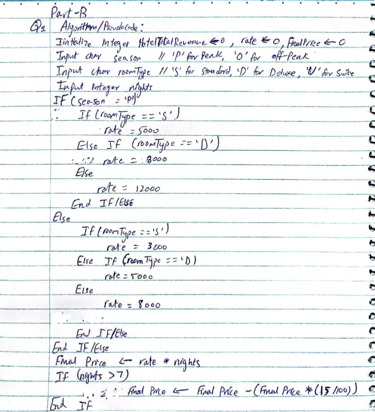
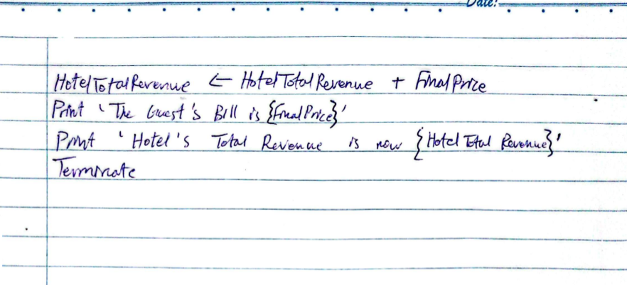
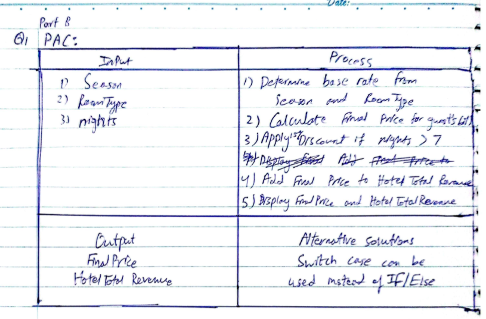
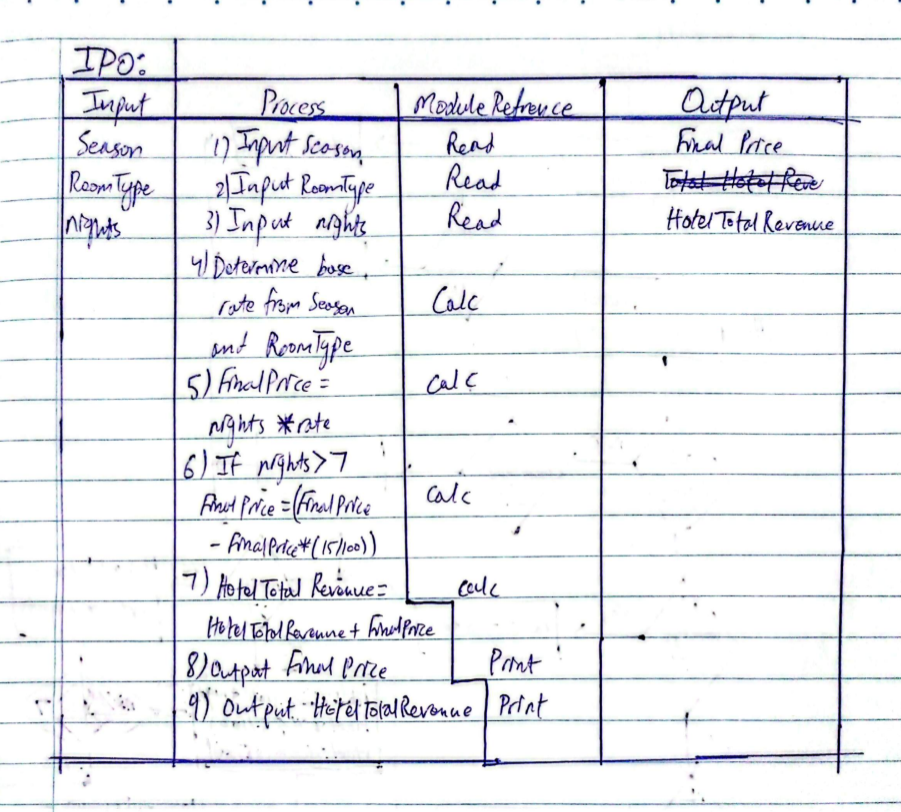
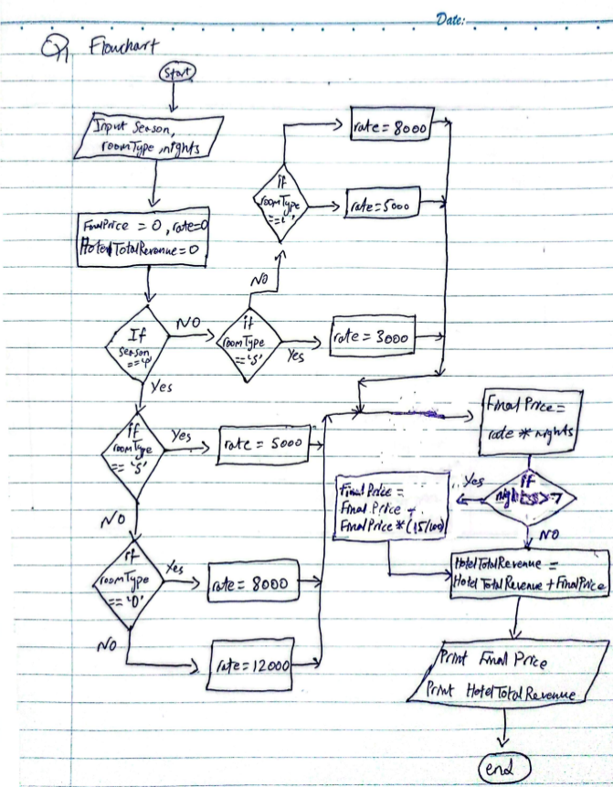

# PartB Q1

## Assumption: Season is entered as 'P' for Peak or 'O' for Off-Peak. Room type is entered as 'S' for Standard, 'D' for Deluxe or 'U' for Suite, and there is no requirement for handling edge cases in the case of inputs. The instructions tell us not to implement loops, but the question mentions looping for N guests, which is a clear contradiction, so the following computational artifacts are only considered for one guest. Initialize variable 'HotelTotalRevenue' to 0 can be removed in case of scaling into N guests.

## Pseudocde/Algorithm:

## PAC and IPO

## Flowchart
