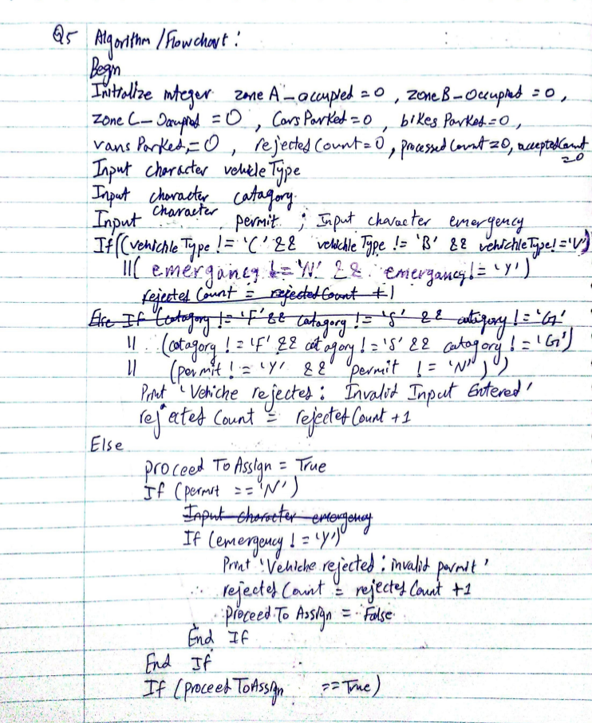
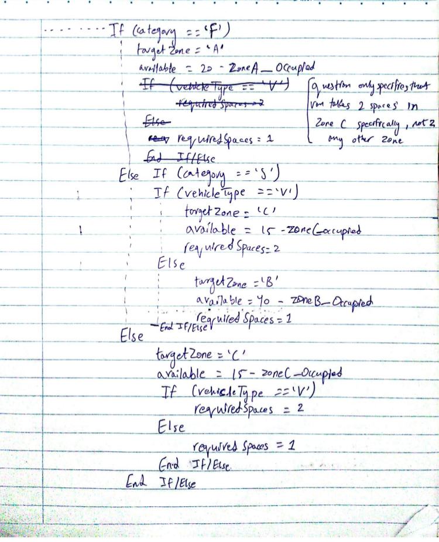
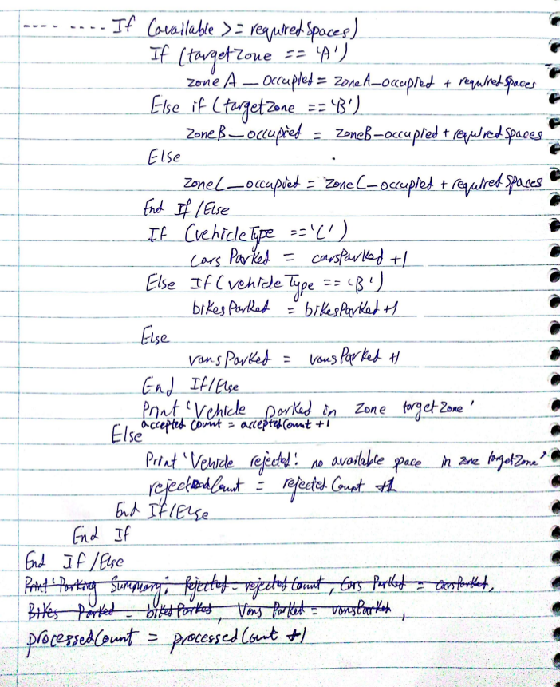
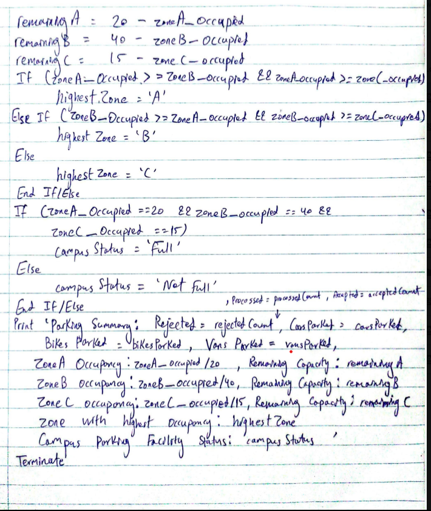
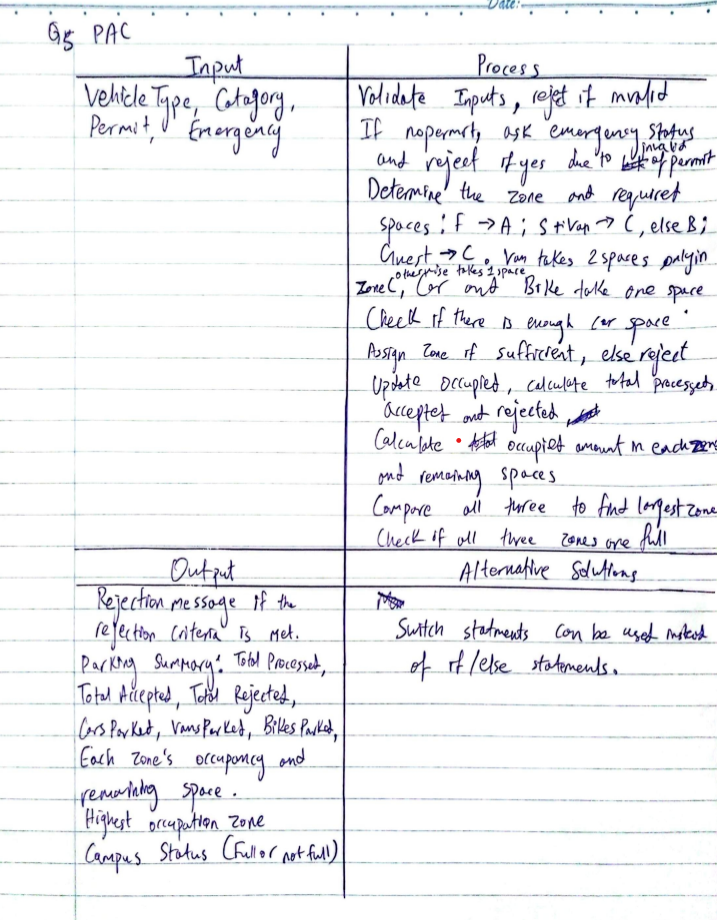
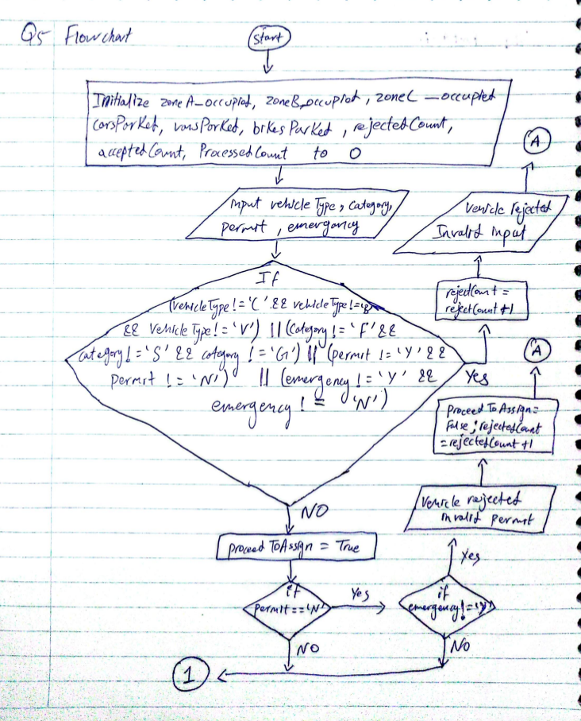
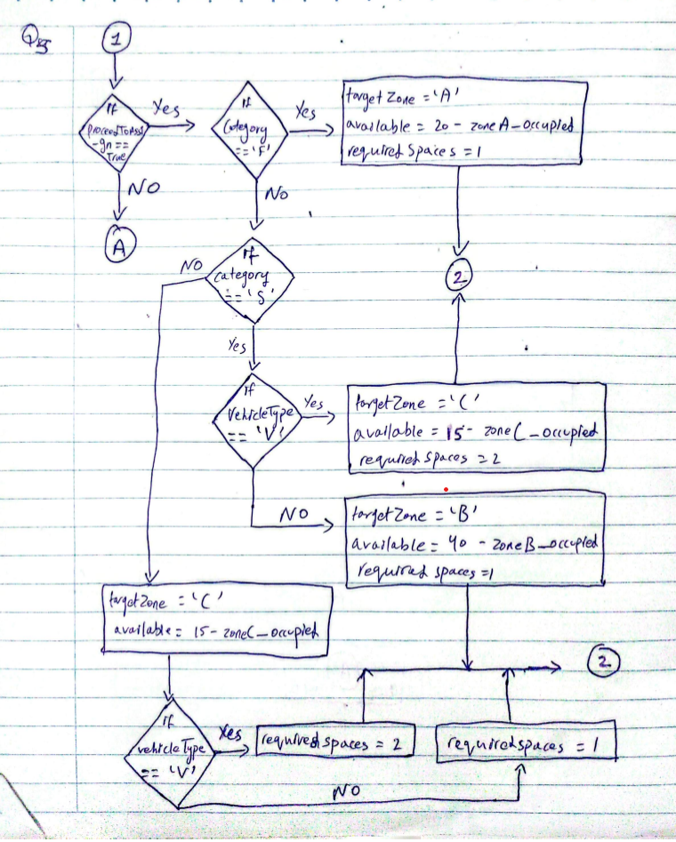
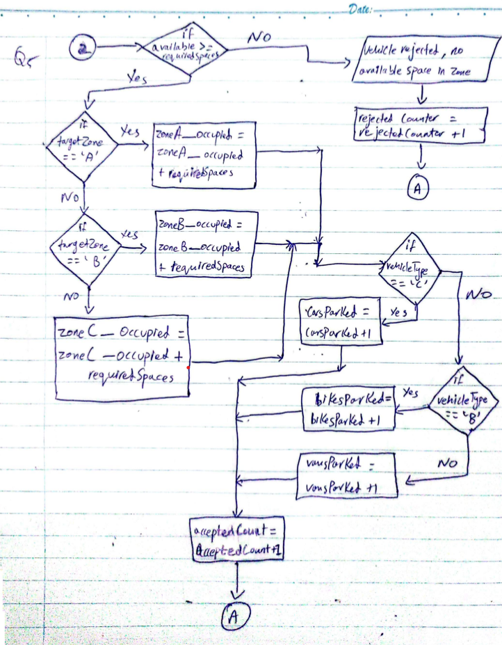
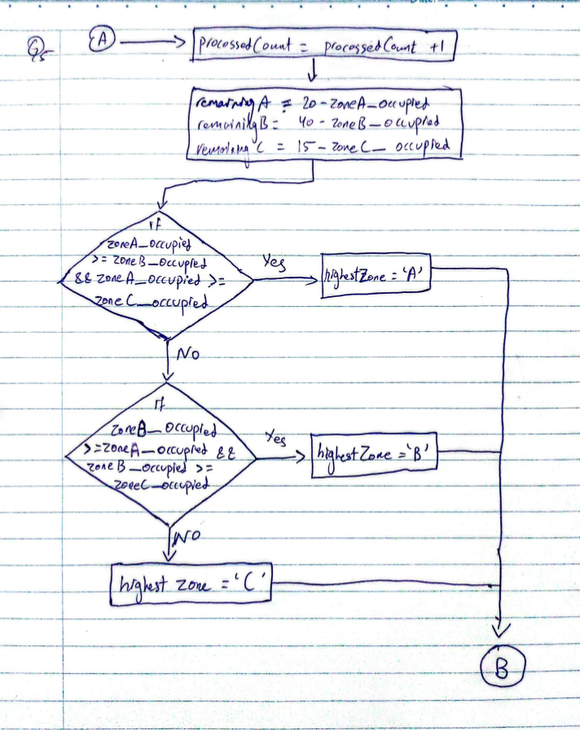
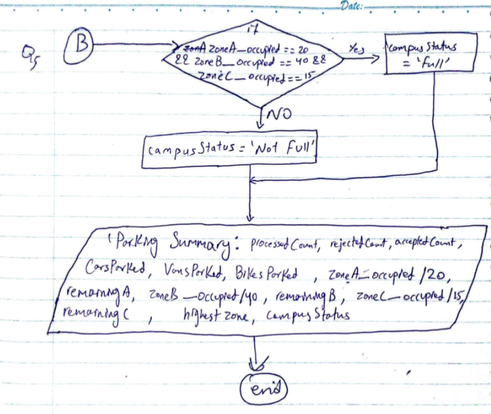

# PartB Q5

## Assumption: Since Part B only requires one iteratiion and not a loop, the user inputting values again after an invalid value is not performed as inputting the values whether valid or invalid is considered as one iteration. Also, the instructions state that vans take 2 spaces in Zone C but doesnt clearly state that it also takes 2 spaces in Zone A as well so this will be treated as a Van taking 2 spaces in Zone C and a van takeing 1 space in Zone A

## Pseudocde/Algorithm:

## PAC and IPO

## Flowchart

